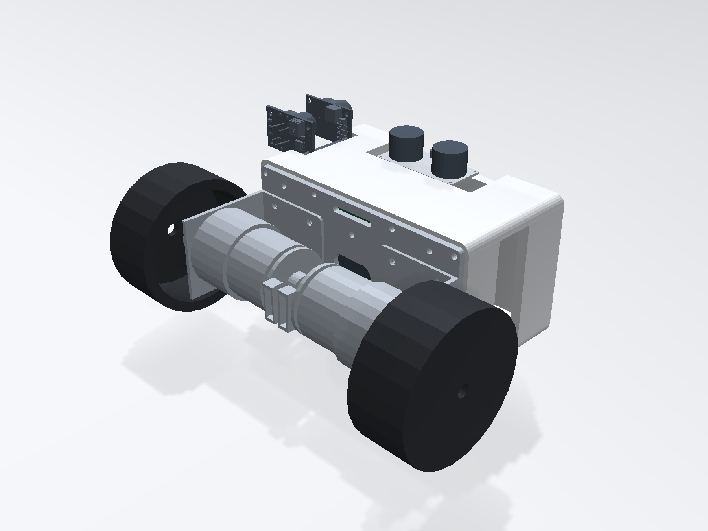
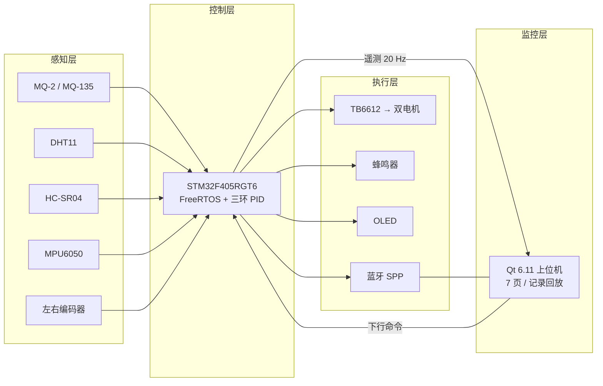
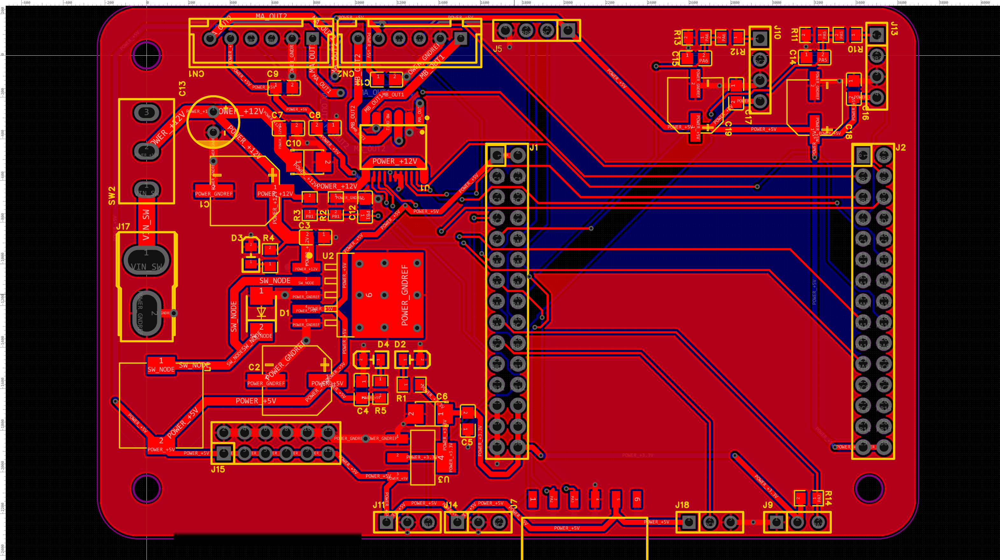

<p align="center">
  
</p>

<h1 align="center">基于平衡小车的仓储环境安全巡检机器人</h1>

<p align="center"><sub>Balance-Car Warehouse Inspection Robot</sub></p>

<p align="center"><b>中国石油大学（华东） 专业生产实习课程项目</b></p>

<p align="center"><a href="README.en.md">English</a> · 简体中文</p>

<p align="center">
  <b>两轮自平衡 · 双路气体 · 边缘研判 · Qt 远程监控</b><br>
  基于 STM32F405 + FreeRTOS + Qt 6 的仓储环境安全巡检小车
</p>

<p align="center">
  
  
  
  
  
  
</p>

<p align="center">
  <a href="#演示">演示</a> ·
  <a href="#快速开始">快速开始</a> ·
  <a href="#系统架构">架构</a> ·
  <a href="#文档导航">文档</a> ·
  <a href="#已知限制">已知限制</a>
</p>

---

## 项目简介

一台面向**仓储环境安全巡检**的两轮自平衡小车：沿预设巡检点自主行进，采集可燃气体、空气质量、温湿度与障碍距离，就地完成超阈值研判和声光报警；姿态、位置与环境数据通过 **20 Hz 遥测**上传 Qt 上位机，操作员可以远程下发巡检任务、运动控制、急停与 PID 调参。

项目是**中国石油大学（华东）专业生产实习课程项目**（测控系统综合设计），按完整产品链路推进：**重做底板 → 焊板测试 → 结构装配 → 固件控制 → 上位机监控 → 真机联调**。仓库里既有原理图、PCB、Gerber、结构模型和装配图，也有可编译的固件、Qt 源码、协议文档和测试记录。

> **范围说明**：本项目**不涉及 MiniBalance 控制板（STM32F405RGT6 版本）的硬件设计与改版**。控制板直接沿用，A1 只重做主底板（原理图 / PCB / 焊接 / 测试）；固件与上位机也不改控制板硬件。

> 目标不是“跑通一个 demo”，而是让每个结论都能回溯到文件、测试或原始记录。

---

## 演示

| 演示 | 时长 | 内容 |
|---|---:|---|
| [▶ 两轮自平衡](demo/videos/平衡.mp4) | 9 s | 松手后保持直立，姿态环与速度环工作 |
| [▶ 超声波避障](demo/videos/避障.mp4) | 9 s | 接近障碍物后停车/转向 |
| [▶ Qt 上位机](demo/videos/上位机.mp4) | 64 s | 总览、曲线、调参、记录/回放 |

<p align="center">
  
  <br>
  <sub>Qt 6.11 上位机：姿态 / 运动 / 电源环境 / 任务巡检 / 诊断 / 状态位 / 链路来源</sub>
</p>

---

## 功能特性

| 能力 | 实现 |
|---|---|
| **自平衡与运动** | 5/10 ms 控制中断 + 三环 PID（直立/速度/转向）；500 ms 失联安全停车并锁存 |
| **环境感知** | MQ-2 + MQ-135 双路气体、DHT11 温湿度、HC-SR04 超声波；气体用 `Rs/R0` 相对量 + 多帧确认 + 迟滞 |
| **自主巡检** | 待机 → 巡航 → 驻留 → 返航/故障状态机；巡检点、完成度、异常标志与事件上报 |
| **通信协议** | 自研 `0xAA55` 帧 + 命令字 + 长度 + CRC-16/MODBUS；20 Hz 遥测、200 ms 心跳、`0x24` 在线调参 |
| **上位机** | Qt 6.11 + QCustomPlot，7 页界面；有线/蓝牙双链路、跨链路去重、CSV + SQLite 记录与回放 |
| **结构与硬件** | 重做 100 × 65 mm 主控底板；SolidWorks 整车装配、A3 装配图、11 对间隙/干涉检查 |

---

## 系统架构



**数据流**：传感器 → 控制中断/FreeRTOS 任务 → 20 Hz 上行帧 → Qt `domain` 聚合 → 7 页界面 / CSV / SQLite；操作员的运动、任务、急停、调参命令按同一协议下行。

---

## 硬件设计

> **范围说明**：控制板为现成的 **MiniBalance STM32F405RGT6 版本**，**本项目不做控制板硬件改版**；A1 的重做对象是底板（原理图 / PCB / 焊接 / 测试）。

### 整车

| 项 | 参数 |
|---|---|
| 平台 | MiniBalance R1 通用车架，两轮共轴 |
| 整车包围盒 | **181.0 × 134.5 × 90.5 mm** |
| 车轮 / 轮距 | Φ65 × 27 mm / **154 mm** |
| 电池包络 | 94.5 × 28.5 × 13.2 mm（3S 18650） |
| 主控板 | **100 × 65 × 1.6 mm**，R5.0，3 × Φ3.2 安装孔 |
| 结构规模 | 14 个命名件 / 20 条装配关系 / 253 个实体 |

### 主控底板

<p align="center">
  
</p>

| 项 | 参数 |
|---|---|
| MCU | STM32F405RGT6（1 MB Flash / 192 KB RAM） |
| 姿态 | MPU6050，5/10 ms 控制中断 |
| 电机驱动 | TB6612，双路 PWM |
| 电机 | MG513P3012V，12 V 减速电机 |
| 气体 | MQ-2 / MQ-135，ADC2，AO 分压后进 PA5/PA6 |
| 温湿度 / 距离 | DHT11（PA7）/ HC-SR04（PC4/PB0） |
| 无线 | 蓝牙 SPP（USART2）+ 有线 USART1，115200 8N1 |
| 显示 / 报警 | 0.96" OLED（I2C）/ 有源蜂鸣器（PC5） |
| 电源 | 12 V → LM2596 → 5 V → AMS1117 → 3.3 V |
| PCB | 2 层，1.6 mm / 1 oz / 有铅喷锡；104 元件 / 52 位号 / 65 网络；523 走线段 / 76 过孔；DRC 0 |

> 引脚、座序、BOM 与制造数据以 [`docs/design_hardware/pin_assignment.md`](docs/design_hardware/pin_assignment.md) 和 [`docs/design_hardware/上板测试记录.md`](docs/design_hardware/上板测试记录.md) 为准；`hardware/gerber/` 是脱敏后的下单 Gerber。

---

## 软件设计

| 层 | 技术 / 关键点 |
|---|---|
| **固件** | C + `arm-none-eabi-gcc` + Makefile；厂商基线 + FreeRTOS 4 任务（Comm / Gas / Task / Ui）；控制中断保留 5/10 ms |
| **控制** | 直立 / 速度 / 转向三环 PID；倾角、低压、失联、急停保护；安全锁存分级解除 |
| **协议** | 帧头 `0xAA55` + 命令字 + 小端长度 + 数据段 + CRC-16/MODBUS；8 类上行帧 / 5 个已实现下行命令 |
| **上位机** | C++17 + Qt 6.11 + QCustomPlot + CMake；五层单向依赖（`protocol ← io ← domain ← data ← ui ← host`） |
| **记录** | CSV 逐帧 42 列 + SQLite 会话/事件/参数三表；支持回放与调参回读 |
| **构建** | 固件 `make` 出 `.hex`；上位机 CMake/Ninja 出 `host.exe`；不需要 Keil |

核心文档：

- 协议 v1.2：[`docs/protocol/communication_protocol.md`](docs/protocol/communication_protocol.md)
- 固件说明：[`docs/design_firmware/程序说明文档.md`](docs/design_firmware/程序说明文档.md)
- 上位机说明：[`docs/design_host/软件设计说明.md`](docs/design_host/软件设计说明.md)
- 结构说明：[`docs/design_mechanical/A2_结构设计说明_初稿.md`](docs/design_mechanical/A2_结构设计说明_初稿.md)

---

## 快速开始

### 1. 克隆仓库

```powershell
git clone https://github.com/pierrotto12138-code/balance-car-inspection-robot.git
cd balance-car-inspection-robot
```

### 2. 编译固件

需要 `arm-none-eabi-gcc` 在 `PATH` 上；不需要 Keil。

```powershell
cd firmware
make                 # 产出 build/MiniBalance.hex / .elf / .bin / .map
make size            # 查看 Flash / RAM 占用
# 有 ST-Link 时：make flash
```

烧录：控制板 MicroUSB 接电脑（板载 CH340G），用 FlyMcu 串口 ISP 选择 `firmware/build/MiniBalance.hex`。

### 3. 编译上位机

需要 Qt 6.11（MinGW 64-bit）、CMake、Ninja。

```powershell
cd host
cmake -S . -B build -G Ninja -DCMAKE_BUILD_TYPE=Release -DCMAKE_PREFIX_PATH="<Qt6>/6.11.2/mingw_64"
cmake --build build
ctest --test-dir build --output-on-failure
```

没有硬件也能跑：

```powershell
# 假源自检：约 3 s 后打印链路统计、状态聚合、告警与事件流
.\build\host.exe --selftest 3 -platform offscreen

# 安全剧本演示：气体冲高 → 告警 → 解除、急停锁存 → 解除、低压
.\build\host.exe --selftest 12 --rate 5 -platform offscreen
```

有硬件时（只读探测，不写参数）：

```powershell
.\build\host.exe --probe COM3 --probe-readback -platform offscreen
```

> 串口打开时程序会显式设置 **DTR=高、RTS=低**，避免 CH340G 自动下载电路把 MCU 停在 BootLoader。

---

## 测试与结果

| 子系统 | 验证结果 |
|---|---|
| **A1 电路** | 原理图 104 元件 / 52 位号 / 65 网络；PCB 523 走线段 / 76 过孔；**DRC 零错误零未连接**；电池实测 11.8 V |
| **A2 结构** | 14 件 / 20 装配关系 / **253 实体**；11 对间隙/干涉检查无穿透；2 处需注意（PCB↔箱体共面、模块 246↔箱体 0.69 mm） |
| **B 固件** | 离线核验 **9 项 / 1,461 条断言**全过；Flash **66,844 B（6.4%）**、RAM **32,832 B（25.0%）**；真机 **611 帧 / 0 丢帧**；7 个 PID 参数 7/7 回读一致 |
| **C 上位机** | `ctest` **7/7（92 项 QTest）** 全过；`--selftest` 退出码 0；便携版 **12 文件 / 37.4 MB** |
| **系统** | 真机稳定平衡，俯仰标准差 **0.79°**；20 Hz 遥测、200 ms 心跳、500 ms 失联停车 |

---

## 目录结构

```text
.
├── firmware/        STM32F405 固件：App / Drivers / FreeRTOS / tests / Makefile
├── host/            Qt 6 上位机：src / tests / third_party / CMakeLists.txt
├── hardware/        PCB 工程、Gerber、BOM、测试记录、实物照片、结构模型与图纸
├── docs/            协议、硬件/固件/上位机设计、交接说明、决策记录、调研
├── demo/            三段演示视频
├── tools/           EDA 桥接、固件离线核验、渲染与文档检查脚本
├── AGENTS.md        AI 编码代理入场须知（路径、铁律、能力边界）
└── README.md
```

---

## 文档导航

| 想了解 | 先看 |
|---|---|
| 新读者 / 项目全貌 | [`docs/handoff/交接说明.md`](docs/handoff/交接说明.md) |
| 全部文档索引 | [`docs/文档索引.md`](docs/文档索引.md) |
| 通信协议 / 帧格式 / 命令表 | [`docs/protocol/communication_protocol.md`](docs/protocol/communication_protocol.md) |
| 电路、引脚、焊接与测试 | [`docs/design_hardware/上板测试记录.md`](docs/design_hardware/上板测试记录.md)、[`docs/design_hardware/pin_assignment.md`](docs/design_hardware/pin_assignment.md) |
| 固件架构与程序说明 | [`docs/design_firmware/architecture.md`](docs/design_firmware/architecture.md)、[`docs/design_firmware/程序说明文档.md`](docs/design_firmware/程序说明文档.md) |
| 上位机设计 / 使用 | [`docs/design_host/软件设计说明.md`](docs/design_host/软件设计说明.md)、[`docs/design_host/用户操作手册.md`](docs/design_host/用户操作手册.md) |
| 结构设计 / 装配图 | [`docs/design_mechanical/A2_结构设计说明_初稿.md`](docs/design_mechanical/A2_结构设计说明_初稿.md)、[`hardware/mechanical/A2-10_整车装配_20261017/图纸/`](hardware/mechanical/A2-10_整车装配_20261017/图纸/) |
| AI 代理接续开发 | [`AGENTS.md`](AGENTS.md) |

---

## 团队分工

| 角色 | 职责 |
|---|---|
| **A1 电路** | 底板重做：原理图、PCB、Gerber、BOM、制板焊接与上电测试 |
| **A2 结构** | 结构方案、外观与人机界面、三维装配、装配图、效果图、间隙检查 |
| **B 程序** | STM32 固件：传感器采集、平衡/运动控制、巡检状态机、协议、安全机制 |
| **C 系统** | Qt 上位机：双链路、监控面板、远程控制、记录回放、联调与交付 |

> 课程：测控系统综合设计（2026-2027-1 学期），第 1 组。公开仓库只保留角色代号，不含姓名/学号。

---

## 已知限制

| 限制 | 说明 |
|---|---|
| **MQ-2 未接入** | 台架当前只有 MQ-135（J13），MQ-2 模块烧毁待补；双路气体只完成单路验证 |
| **气体 ppm 未标定** | `RL`/`R0` 未实测，ppm 只作估计值；主判据是 `Rs/R0` 相对量 |
| **蓝牙 SPP 未端到端** | Windows 可配对但建不出 COM 口；演示与联调以有线 USART1 为主 |
| **3D 模型不可直接打印** | 结构模型**仅按作业提交要求完成，未实际验证**；上下壳未建模，整机 STL 是单网格，**直接打印这个模型肯定不行** |
| **单机实验室验证** | 未做长期运行、多机管理与现场环境测试；结构只做 11 对关键间隙，不含公差 |

---

## Roadmap

- [x] 重做底板：原理图 / PCB / Gerber / BOM / 焊接测试
- [x] 结构：整车装配 / 装配图 / 效果图 / 间隙检查
- [x] 固件：FreeRTOS 四任务 / 三环 PID / 巡检状态机 / 协议 v1.2 / 安全链
- [x] 上位机：7 页界面 / 双链路 / 记录回放 / 在线调参 / 92 项测试
- [x] 真机联调：平衡 / 611 帧 0 丢帧 / 7 参数回读
- [ ] 补 MQ-2 并完成双路标定（`RL`/`R0`）
- [ ] 补建上下壳，按“在对应位置开框”打印试装
- [ ] 修蓝牙 SPP 端到端（驱动/配对/波特率）
- [ ] 多机管理与长期运行统计

---

## 致谢

- 学校提供的 **MiniBalance V5.0** 平衡小车平台与 STM32 控制板
- **STM32Cube** / `arm-none-eabi-gcc` / **FreeRTOS**
- **Qt 6** / **QCustomPlot**
- 课程指导教师与第 1 组全体成员

## 许可

本项目原创代码与文档采用 **MIT License**，见 [`LICENSE`](LICENSE)。第三方组件（STM32 StdPeriph/HAL、FreeRTOS、Qt、QCustomPlot 等）不在该许可范围内，遵循各自原始许可证。
