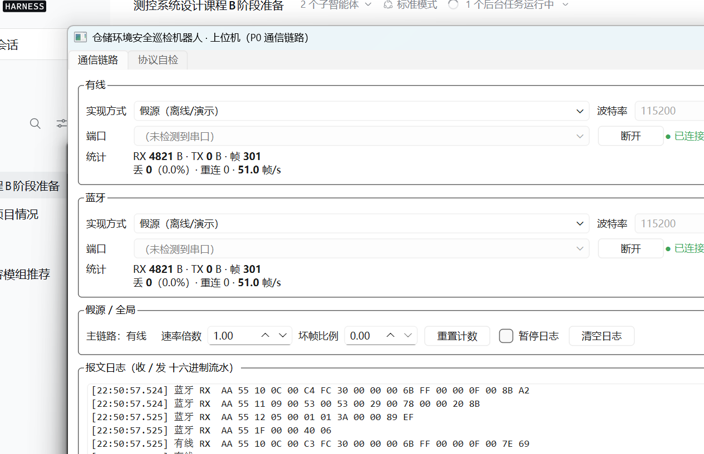
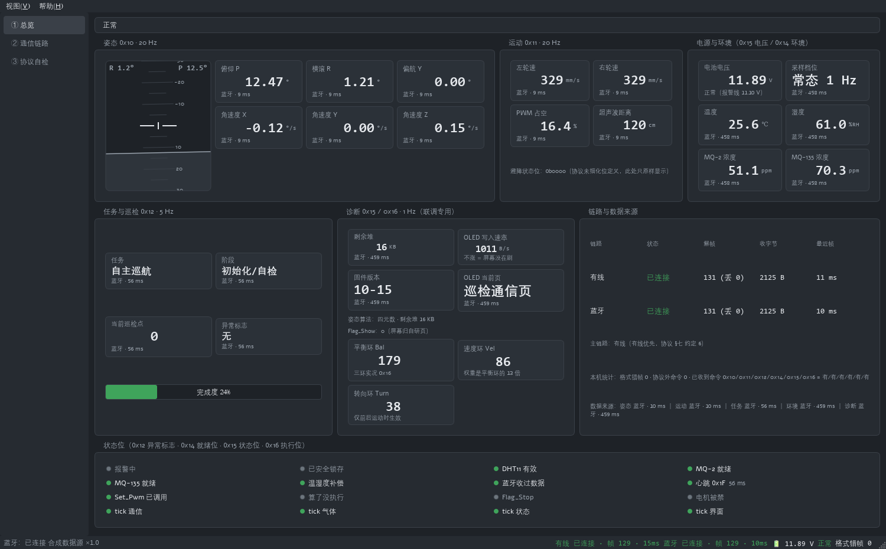
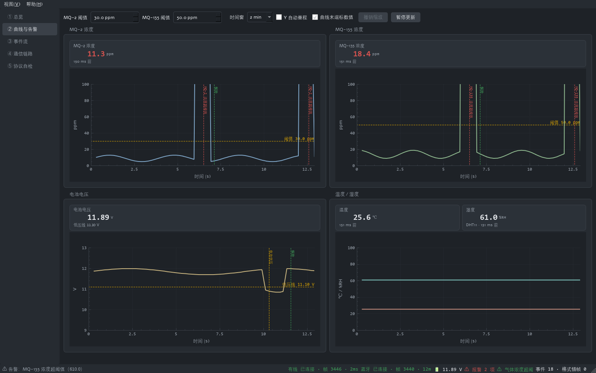
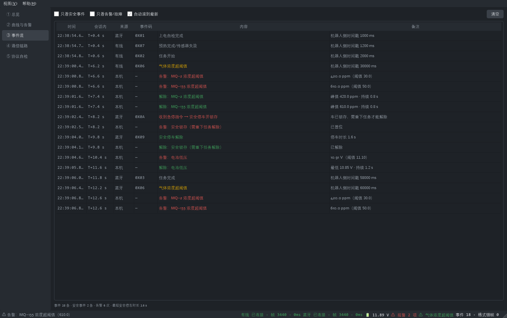
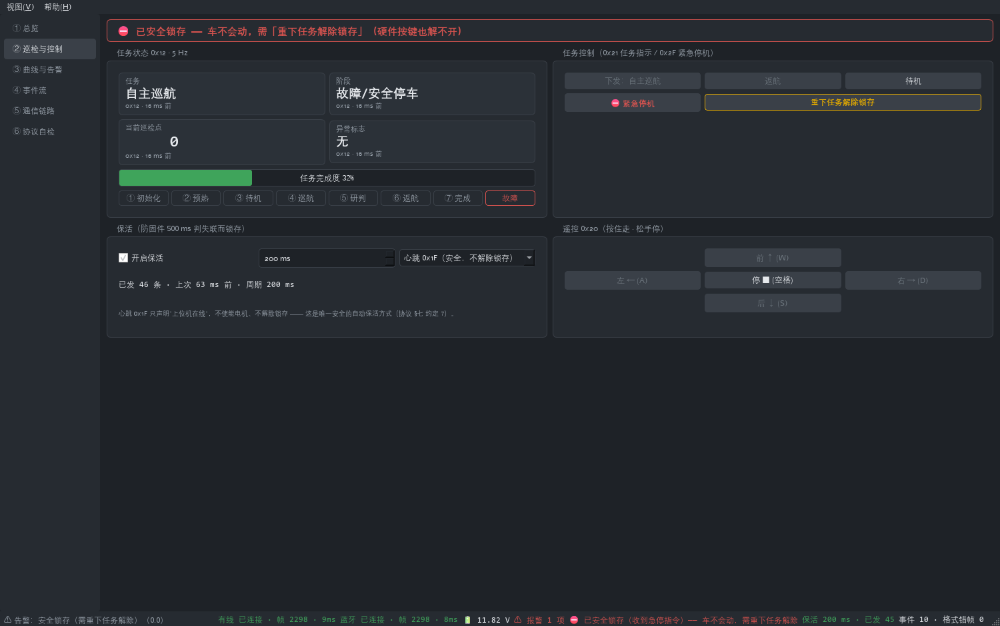
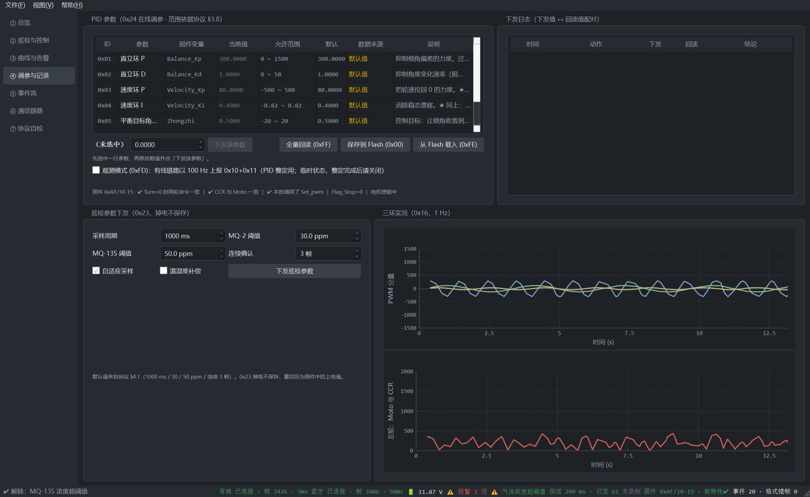

# 上位机（角色 C）— PC 端监控系统

> 📋 **开工前先读**：[`../docs/design_host/C部分方案与计划.md`](../docs/design_host/C部分方案与计划.md) —— 调研结论 / 技术选型 / 五层模块 / 线程与数据模型 / UI 布局与配色 / P0~P5 计划。
> 📄 **协议基线**：[`../docs/protocol/communication_protocol.md`](../docs/protocol/communication_protocol.md) **v1.2**（v1.1 冻结版 + `0x15` 诊断 / `0x16` 三环实况增量；含 §七 给上位机的显示约定 13 条）。

> **状态：P0~P5 全部完成（C 部分收工）**（2026-10-15）—— `protocol/` + `io/` + `domain/`（units/frames/vehicle_state/alarm/commands/keepalive）+ `data/`（event_log/param_store/recorder）+ 七个界面页
> （总览 / 巡检与控制 / 曲线与告警 / 调参与记录 / 事件流 / 通信链路 / 协议自检）+ **一键打包**（`package.ps1` → 便携目录 **12 文件 / 37.4 MB**，免装 Qt）。
> `ctest` **7/7 通过**（协议 13 + 链路 8 + domain 15 + 界面 11 + 告警 13 + 命令/保活 13 + **记录/回放/参数 13**）；`host.exe --selftest 3 -platform offscreen` 退出码 **0**。
> **没有板子也能开发/演示**：假源内置剧本（每 30 s 气体冲高、每 60 s 急停锁存→解除、50~56 s 低压），
> `--demo --rate 5` 约 12 s 就能把"报警 → 曲线留痕 → 事件流留档 → 锁存 → 重下任务解除"整套演完；`--play 记录.csv` 可用录制数据驱动整个界面。
> **有板子时**：`--probe COM3 --probe-readback` 一条命令把"链路 / 各命令字条数 / 状态聚合 / **0x24 七个实际生效值逐项对照** / 0x16 判读"一次打全（**只读**，见 §二之三）。
> 交付文档：[软件设计说明](../docs/design_host/软件设计说明.md) · [用户操作手册](../docs/design_host/用户操作手册.md) · [演示脚本](../docs/design_host/演示脚本.md)。

> 📌 **来自 B 侧的对接说明（2026-10-09，务必看一下）**
> 1. **协议测试向量已就绪**：[`../docs/protocol/test_vectors.json`](../docs/protocol/test_vectors.json)（`.tsv` 便于脚本比对）——
>    CRC **4** + 帧 **16** + 流式 **6** 条，由独立的 Python 实现生成；**B 侧固件已逐条复现、并用你的 `host/src/protocol/*.cpp` 复算过，结果一致**。
>    请把 C 的单元测试也对齐这份向量（原文档里有一个真实错误：`0x11` 的 N 由 11 改成 **9**，已在协议文档修正）。
> 2. **固件侧已实现的 `0x24` 扩展参数 ID**：`0xFF` 全量回读（回 7 条 0x24）· `0x00` 存 Flash · `0xFE` 从 Flash 重新载入 · `0xFD` 调参观测模式（开=有线链路 100 Hz 上报 0x10+0x11）。
>    **帧格式不变**（仍 N=6）；不认识就完全不发，兼容无风险。
>    ✅ **已在协议 v1.1 会签通过并冻结**（决策 57），不再是"待确认"；
>    另注 `0x24` 自 v1.2 起有**参数范围校验**（越界/NaN 一律拒绝且不改动生效值，见协议 §3.8）。
> 3. **两条链路对等**：蓝牙（USART2）与**有线调试链路**（USART1，115200 8N1）跑同一套协议，
>    周期上报与事件告警**两条都发**；上行数据字段与来源见 [`../docs/design_firmware/程序说明文档.md`](../docs/design_firmware/程序说明文档.md) §5.5。
> 4. **失联锁存必须处理（★ 本轮联调新增）**：上位机静默 **>500 ms** ⇒ 板子锁存安全停车，
>    **硬件按键也解不开**。上位机必须**持续使能/保活**（≤200 ms 一次 `0x20 enable=1`，或任意合法下行帧作心跳）。
>    ✅ 事件码已补齐：**`0x08` 失联停车 / `0x09` 解除 / `0x0A` 收到急停**（三者带时间戳、成对出现，决策 57）。
> 5. **本轮（2026-10-15）B 侧新增的上行帧**：`0x15` 诊断（N=16，电压/页号/`Flag_Show`/算法/状态位/
>    剩余堆/**OLED 写计数**/四任务 tick）与 `0x16` 三环实况（N=20，`Bal/Vel/Turn` + `Moto` vs **真实 CCR** +
>    编码器**原始计数** + 状态位；**偏移 19 = 固件版本字节** `(月<<4)|日`，当前 `0xAF`）。
>    **建议**：连上板子的第一件事就是读 `0x16` 偏移 19 确认"烧的到底是哪一版"。

## 一、当前进展

| 模块 | 状态 | 说明 |
|---|---|---|
| `src/protocol/` 协议层 | ✅ **完成并已验证** | CRC-16/MODBUS、组帧、流式解帧状态机；**13 项单元测试全部通过**。`frame.h` 已跟上 **v1.2**：`kMotion = 0x11` 的 **N=9**（不是 11）、新增 **`kDiag=0x15`** / **`kLoop=0x16`**、补齐安全通道事件码 **`0x08`/`0x09`/`0x0A`** |
| 打开串口 | ⚠️ **必须显式驱动 DTR/RTS** | 本板 CH340G 把 DTR 接复位、RTS 接 BOOT0；串口一打开驱动默认把两者拉高 ⇒ MCU 停在 BootLoader ⇒ **端口能开、一个字节都收不到**。**运行态 DTR=高、RTS=低**（AGENTS 铁律 33）|
| 蓝牙链路 | ⚠️ **Windows 上暂不通** | 蓝牙 SPP **能配对但建不出 COM 口**；`pybluez2` 在 Python 3.13 上编译不过；本 Qt 套件**未安装 Qt Bluetooth 模块**。**P1 用有线链路（USART1）做主线**；端口识别按**合法帧**判定（参考 [`../tools/fw_prep/bt_scan.py`](../tools/fw_prep/bt_scan.py)，决策 61）|
| `src/io/` 链路层 | ✅ **P0 完成** | `LinkBase` 抽象 + `SerialLink`（QSerialPort + 工作线程阻塞读 + 自动重连）+ `ReplayLink`（假源/录制回放，离线开发与演示兜底）+ `LinkManager`（双链路、主链路优先、统计）|
| `src/domain/` 领域层 | ✅ **P1~P3 完成** | `units`（协议定点量的**唯一**换算与格式化处）、`frames`（8 类上行帧结构体 + **精确长度**校验的解析 + 名称表）、`vehicle_state`（双链路合并 + **跨链路去重**、来源与新鲜度、格式错帧/协议外命令/重复帧计数、安全锁存判定、OLED 写速率与四任务 tick 存活）、`alarm`（连续确认 + 迟滞 + 状态跃变才报）、**`commands`（下行数据段唯一出处 + 安全影响分类）**、**`keepalive`（默认心跳 0x1F 保活，防固件 500 ms 判失联）** |
| `src/data/` 数据层 | ✅ **P2/P4 完成** | `event_log`（机器人事件/本机告警/**操作员动作**同轴，安全事件成对给停车时长）、**`param_store`**（7 个 PID 参数的定义/范围/默认值 + **下发前校验** + **下发↔回读配对** + 巡检参数账本）、**`recorder`**（**CSV 逐帧 42 列含原始帧 HEX** + **SQLite 会话/事件/参数三表**）|
| `src/ui/` 界面 | ✅ **P1~P4 完成** | **总览**（姿态+人工地平仪 / 运动 / 电源环境 / 任务巡检 / 诊断 / 状态位 LED / 链路来源 + 安全横幅 + **0x16 判读结论**）、**巡检与控制**（阶段时间轴 + 任务下发/急停/解除锁存 + 保活 + 按住走松手停）、**曲线与告警**（四张通道独立曲线 + 阈值线 + 告警标记 + 十字定标）、**调参与记录**（参数表 / Flash / 观测模式 / 三环曲线 / 下发日志）、**事件流**、**通信链路**、协议自检；状态条含假源水印·保活·**录制**·**固件版本** |
| 打包与文档（P5） | ✅ **完成** | `package.ps1`：Release 树 → `windeployqt` → 瘦身（**109 → 37.4 MB**）→ **干净 PATH 下四项校验**；产出 `dist/上位机/`（12 文件）；交付文档三份见 §二之八 |

## 二、构建与测试

工具链（均已就绪）：

- Qt **6.11.2** MinGW 64-bit（`<Qt 安装目录>/6.11.2/mingw_64`）
- MinGW **g++ 13.1.0**（`<Qt 安装目录>/Tools/mingw1310_64/bin`，或任意 g++ ≥ 11）
- CMake **4.3.1** + Ninja

```bash
# 一次性配置
export PATH="<Qt 安装目录>/Tools/mingw1310_64/bin:<Qt 安装目录>/Tools/Ninja:<Qt 安装目录>/6.11.2/mingw_64/bin:$PATH"
cmake -S . -B build -G Ninja -DCMAKE_BUILD_TYPE=Debug \
      -DCMAKE_PREFIX_PATH="<Qt 安装目录>/6.11.2/mingw_64"

# 构建
cmake --build build

# 跑单元测试（7 个目标：协议 13 + 链路 8 + domain 15 + 界面 11 + 告警 13 + 命令/保活 13 + 记录/回放/参数 13）
ctest --test-dir build --output-on-failure

# 无界面自检：两条链路都切假源，跑 3 s 打印**链路统计 + 状态聚合 + 告警与事件流 + 保活**并退出（0 = 正常）
./build/host.exe --selftest 3 -platform offscreen

# ★ 把假源的安全剧本一次演完（约 12 s 实时 ≈ 60 s 虚拟）：气体冲高→告警→解除、急停锁存→解除、低压
./build/host.exe --selftest 12 --rate 5 -platform offscreen

# ★ 真机只读探测 + 0x24 全量回读（不写参数、不动 Flash；自动打心跳）
./build/host.exe --probe COM3 --probe-readback -platform offscreen

# ★ 录制 30 s，再用录制文件回放驱动界面（验证"记录能被回放"，不需要硬件）
./build/host.exe --demo --rate 5 --record build/capture.csv
./build/host.exe --play build/capture.csv

# 单个测试目标
./build/test_codec.exe          # 期望：13 passed
./build/test_link.exe           # 期望：8 passed（全在假源上跑）
./build/test_domain.exe         # 期望：15 passed（含冻结向量逐字段比对、跨链路去重）
./build/test_alarm.exe          # 期望：13 passed（连续确认/迟滞/事件流配对）
./build/test_command.exe        # 期望：13 passed（下行帧往返、钳位、保活行为）
./build/test_data.exe           # 期望：12 passed（CSV/回放/SQLite/参数账本）
./build/test_ui.exe -platform offscreen   # 期望：11 passed（界面冒烟，不需要显示器）

# 跑上位机（有板子：在界面里选端口点连接；没有板子：用假源）
./build/host.exe
./build/host.exe --demo          # 两条链路都切假源并自动连接（演示模式，打开就有数据）
./build/host.exe --demo --rate 5 # 五倍速：约 12 s 演完一整套报警→解除剧本
```

> **注意**：`host.exe` 是动态链接 Qt 的，直接拷到别的机器需要 `windeployqt`。最终交付时须打包依赖。

### 二之三、P1 新增的三个命令行开关（联调与文档都用得上）

```bash
# ① 真机只读探测（联调第一现场：端口通不通、哪些命令字真的在发、状态聚合长什么样）
./build/host.exe --probe COM3 --probe-seconds 10 --probe-heartbeat
#    · 默认**不发任何下行帧** ⇒ 固件 500 ms 后判失联并锁存安全停车（想让车保持在线就加 --probe-heartbeat，
#      它每 200 ms 发一条 0x1F 心跳；★ 心跳**不会**解除锁存，也不会产生任何运动）
#    · 输出：链路状态变化（含"端口被占用/串口在运行中断开"的原文）、实测时长、结束时最近帧年龄、
#      关闭链路耗时、收/发字节/解帧/丢帧、**各命令字实际收到条数**、完整状态聚合
#
# ①' 加 --probe-readback：再发一条 0x24 全量回读(0xFF) —— **只读命令**（不写参数、不动 Flash），
#     并把 7 个"实际生效值"与参数定义表/本机定稿值逐项对照，同时给出 0x16 的三个判读组合。
#     真机实测（2026-10-15）：7 条全部回显、固件版本 0xAF/10-15；见 ../docs/design_host/C部分方案与计划.md §十六
./build/host.exe --probe COM3 --probe-readback -platform offscreen

# ② 自动截图（文档里的界面截图用它生成，界面改了重跑一次即可，不会出现"图过期"）
./build/host.exe --demo --rate 5 --shot ../docs/design_host/图/P4_调参与记录.png \
                 --shot-delay 13000 --shot-tab 3
#    · 无显示器时加 -platform offscreen，并设 QT_QPA_FONTDIR=C:\Windows\Fonts（否则没有字体，整屏方框）
#    · --shot-tab：0=总览 1=巡检与控制 2=曲线与告警 3=调参与记录 4=事件流 5=通信链路 6=协议自检
#    · --shot-delay 13000 配 --rate 5：让假源先跑完 60 s 虚拟时间的剧本，图上才有告警标记
#    · 想拍"锁存"那一屏：--rate 5 --shot-delay 8800（虚拟 44 s ∈ 急停锁存窗口 40~48 s）
#    · --size 1366x768：强制窗口尺寸（小屏验证用；默认按屏幕自适应，窗口不会再比屏幕大）

# ③ 录制与回放（现场复盘 / 无硬件演示）
./build/host.exe --record build/capture.csv          # 启动即录制（CSV 逐帧 + SQLite 会话）
./build/host.exe --play build/capture.csv            # 用记录驱动界面（走假源链路，同一套数据通路）
#    · 界面上也可以：文件菜单 → 开始录制（Ctrl+R）/ 停止 / 打开记录文件回放

# ④ 每次改动后的固定自检（提交前跑一遍）
cmake --build build && ctest --test-dir build --output-on-failure \
  && ./build/host.exe --selftest 3 -platform offscreen
```

## 三、协议层设计要点

**分层原则：协议层不依赖任何 GUI**，因此可以独立编译与单元测试（当前测试目标就是只链接 `protocol` 静态库，不链接 Qt Widgets）。

```
src/protocol/
├── crc16.h/.cpp     CRC-16/MODBUS（标准向量 0x4B37 已验证）
├── frame.h          协议常量：命令字、阶段枚举、事件码、任务 ID、PID 参数 ID
└── codec.h/.cpp     组帧 encodeFrame() + 流式解帧 FrameDecoder
```

**解帧器必须处理的三件事**（都有对应测试）：

1. **分片重组**——串口读到的字节流边界与帧边界无关，必须逐字节喂入状态机（`stream_splitAcrossReads`）
2. **坏帧丢弃**——CRC 校验失败丢弃整帧（`corrupt_crcIsDropped`）
3. **重新同步**——帧前有垃圾字节、或校验失败后的字节本身可能是下一帧帧头，都要能恢复（`resync_afterGarbage`）

**唯一依据**是 `docs/protocol/communication_protocol.md`。任何字段改动必须同步改该文档与 `frame.h`，并升级版本号。

## 二之二、P0 怎么用（含**没有板子**时怎么开发）



> 假源模式下两条链路都在跑：统计在涨、HEX 日志滚动（AA 55 10 0C … = 0x10 姿态 N=12；AA 55 11 09 … = 0x11 运动 N=9）。

界面里每条链路都有一个 **「实现方式」** 下拉框：

| 方式 | 用途 |
|---|---|
| **真实串口** | 板子在手边时用。端口下拉自动枚举；波特率默认 115200（与协议一致）；断开后**自动重连** |
| **假源（离线/演示）** | 板子不在手边、或演示现场硬件故障时用。合成数据按协议真实周期产帧（0x10/0x11 20 Hz、0x12/0x1F 5 Hz、0x14 1 Hz），坏帧比例可调，用来验证「丢帧计数」确实在工作 |

**P0 的验收步骤**（与计划书一致）：

1. 假源 ×1.0 跑 1 min：看两路「解帧」在涨、「丢帧」为 0、「帧率」约 **51 帧/s**；
2. 把「速率倍数」调到 **10**：帧率应约 **510 帧/s 且仍然 0 丢帧**（压测界面不卡、计数不乱）；
3. 把「坏帧比例」调到 **1.00**：**丢帧数应随之增长、解帧数不再增长** —— 这一步在验证「统计不是摆设」；
4. 有板子时：切「真实串口」连上应看到同样的帧在涨；拔掉串口线应看到「错误 + 自动重连」；
5. 命令行等价验证：`host.exe --selftest 3 -platform offscreen` → 退出码 **0**。

> **P0 踩到的两个坑**（已写进代码注释与 `AGENTS.md` §3.5）：
> ① 假源**必须自己解帧** —— 真串口是在读线程里解的，假源若只发原始字节，上层永远收不到帧；
> ② **Windows 定时器粒度 ≈15.6 ms**：按「节拍 × 倍数」累计虚拟时间会让产帧率掉到标称值的 1/3 ——
>    改成用 `QElapsedTimer` 量真实经过时间后再乘倍数。

## 二之四、P1 怎么用（总览面板 / 怎么看"有没有异常"）



**一屏之内回答四个问题**（这也是 P1 的验收口径）：

| # | 问题 | 界面上的位置 | 怎么看 |
|---|---|---|---|
| 1 | 车在哪、什么姿态、动不动 | 「姿态」组（人工地平仪 + 俯仰/横滚/偏航 + 三轴角速度）、「运动」组（左右轮速/PWM/超声/避障位） | 地平线倾斜=横滚、上下平移=俯仰；数值**单位在卡片上写明**（°、mm/s、cm）|
| 2 | 环境与电够不够 | 「电源与环境」组 | 电压卡片按 **11.10 V 报警线**着色；**传感器未就绪时显示"--（未就绪）"而不是 0** —— 0 会被读成"空气很干净" |
| 3 | 任务走到哪一步 | 「任务与巡检」组 | 任务/阶段/完成度进度条/巡检点/异常标志位（异常标志是**位域**，逐位给中文）|
| 4 | **有没有异常、锁没锁、数据可不可信** | 顶部**安全横幅** + 「状态位」LED 组 + 「链路与数据来源」组 | 横幅只有三种颜色（中性/琥珀/红）；LED 逐位显示 `0x12` 异常标志 / `0x14` 就绪位 / `0x15` 状态位 / `0x16` 执行位；链路组给出**双链路各自的解帧数与最近帧年龄**、**格式错帧数**（≠0 就是"固件与协议不一致"的第一证据）|

**三条界面纪律**（改界面时请守住，否则"监控台"会退化成"好看的仪表盘"）：

1. **界面不解析字节**：所有字段偏移与单位换算都在 `src/domain/`，界面只读结构体；
2. **过期要看得出来**：某类帧超过其周期数倍没更新时，对应数值**置灰并标注"已过期 N ms"** ——
   "画面冻住"绝不能看起来像"车停住了"（这是监控系统最危险的一类错误）；
3. **颜色只表达异常**：正常一律中性灰、警示琥珀、报警红、离线灰，绿色只用于状态灯（ISA-101，见 `src/ui/theme/theme.h`）。

**P1 的验收步骤**（命令都写在 §二之三）：

1. `ctest --test-dir build --output-on-failure` → **4/4**；
2. `host.exe --selftest 3 -platform offscreen` → 退出码 **0**，并打印出完整的**状态聚合**；
3. `host.exe --demo` → 打开就能看到假源数据在跑（含每 30 s 气体冲高、每 60 s 急停锁存→解除、50~56 s 低压窗口）；
4. 有板子时：`host.exe --probe COM3 --probe-seconds 10 --probe-heartbeat` → 解帧在涨、格式错帧 0、各命令字都有条数；
5. 界面里连上真板子：让车动一下（或手持倾斜），**姿态/轮速数值跟着变**；拔线时状态条与横幅提示链路超时、数值置灰。

> **P1 的一个真实教训**（值得记住）：`--probe` 每次结束都显示"最近帧年龄 ≈3000 ms"，
> 第一反应是"关闭串口阻塞了 3 秒"。加上**实测时长**与**关闭耗时**两个数之后才看清：
> 关闭只用 0~9 ms，真相是**串口在运行中消失了**（台架被拔/重枚举 → 读取错误 → 读循环退出）。
> **"数据停了"要先看链路状态与错误文本，不要先怀疑收尾代码。**

## 二之五、P2 怎么用（曲线与告警 / 事件流）




**曲线页**（② 曲线与告警）：四张**通道独立**的图（MQ-2 / MQ-135 / 电压 / 温湿度），每张图上方一个当前值卡片；
图上有一条**阈值/低压参考线**（虚线），告警发生与解除会在当时的时刻打**竖线标记**（红=发生、绿=解除）。

| 操作 | 效果 |
|---|---|
| 鼠标在图内移动 | **十字定标**：底部显示 `t 12.3 s · 45.6 ppm` |
| 滚轮 | 缩放（X/Y 同时）；**双击图内**或点「撤销缩放」复位 |
| 按住拖动 | 平移（"撤销缩放"按钮会亮起提示已被缩放） |
| 时间窗下拉 | 30 s / 2 min / 10 min |
| 阈值输入框 | 改**本机**判定阈值（默认 30 / 50 ppm，与协议 `0x23` 默认一致）；曲线量程随之调整 |
| 暂停更新 | 冻结画面读波形（**暂停期间不采样**，恢复时图上会留一条"暂停结束"标记 —— 免得那条直连线被误读成"中间一直在测"） |

**事件流页**（③ 事件流）：机器人事件（`0x13`）与**本机告警**同轴排列；安全事件成对显示 ——
`0x0A` 急停 / `0x08` 失联 一行，`0x09` 解除 一行并直接给出**停车时长**；底部常显
「事件 N 条 · 安全事件 M 条 · 告警 K 次 · 最短安全停车时长 x s」——**这是"安全"一项可量化的证据**。
两个过滤框（只看安全事件 / 只看告警故障）与"清空"按钮在工具条上。

> **P2 修掉的一个"看不见"的缺陷**（值得记住）：协议规定**两条链路都发同样的帧**，
> 而曲线采样、告警的"连续确认"、事件流都是**按帧计数**的 ⇒ 同一次测量被算两次：
> 事件流每条出现两遍、"连续确认 3 帧"被 1.5 次真实采样满足。
> 现在去重统一在 `domain/vehicle_state`（同命令字 + 内容逐字节相同 + 不同链路 + ≤150 ms），
> 并把 `重复帧` 计数显示在总览页与自检输出里 —— **去重了多少条要看得见**。

**键盘**：`F11` 快速截图（存到 `AppDataLocation/shots/`，路径自动进剪贴板）；`空格` 暂停/恢复界面更新。

## 二之六、P3 怎么用（巡检与控制 / 保活）



| 区域 | 内容 | 要点 |
|---|---|---|
| 顶部横幅 | 锁存 / 报警 / 正常 | 锁存时红字写明"**需「重下任务解除锁存」（硬件按键也解不开）**" |
| 任务状态 | 任务 / 阶段 / 巡检点 / 异常标志 + 完成度 + **阶段时间轴**（①初始化…⑦完成，故障单列红牌） | 时间轴用位置表达进度（ISA-101：靠位置读状态） |
| 任务控制 | 下发巡航/返航/待机（`0x21`）、**⛔紧急停机**（`0x2F`）、**重下任务解除锁存** | **锁存期间巡航/返航/方向键全部禁用**（按不动，而不是只提示）；急停不做二次确认 |
| 保活 | 开关 + 周期（默认 200 ms）+ 方式（默认**心跳 0x1F**）+ 已发条数/上次时刻 | ★ **绝不要用"使能 0x20"当保活**：协议规定收到使能位=1 即解除安全锁存 ⇒ 每 200 ms 自动拆掉一次急停保护。选它时界面会红字告警 |
| 遥控 | 前/后/左/右（按住走、松手停）+ 停；键盘 `W A S D` / `空格` | 松手发 `0x20 enable=0`（立即停）；锁存期间同样禁用 |

**为什么保活是必需的**（协议 §五 / §11.5 第 6 条）：固件只要 **500 ms 没收到任何下行帧** 就安全停车**并锁存**，
而锁存之后**硬件按键也解不开** —— 也就是说，上位机"安静半秒"，车就停并锁住。所以本程序：
默认开启保活（200 ms，留 2.5 倍余量）、打开时**立刻**发第一条、链路不通时**不发**并显示"待链路"。
**想演示"失联保护"**：把保活关掉，500 ms 后车会自己锁存，界面横幅立刻变红 —— 这条演示路径不用动任何线。

## 二之七、P4 怎么用（调参与记录）



**调参页**（④ 调参与记录）：

| 区域 | 用法 | 要点 |
|---|---|---|
| PID 参数表 | 选中一行 → 上方输入框改值 → **下发该参数** | 输入框**按协议范围限制**（越界在界面上就填不进去）；「当前值」灰显=**还没回读到**、显示的是默认值；「数据来源」= 已回读✔ / 待回读 / 默认值 |
| Flash | **保存到 Flash (0x00)** / **从 Flash 载入 (0xFE)** | 掉电保存；回执 0.0 = 成功 |
| 观测模式 (0xFD) | 勾选即下发 | 有线链路 100 Hz 上报 `0x10+0x11`（PID 整定用）——**临时状态，整定完请关掉** |
| 全量回读 (0xFF) | 一次要回 7 条 `0x24` | 联调第一件事：确认"板上实际生效值"是什么 |
| 下发日志 | 每一条**下发值 ↔ 回读值 ↔ 结论** | ★ 不一致会标红（`✘ 与下发不一致`）—— 这是"以为改了、其实没收到"的第一现场 |
| 巡检参数 (0x23) | 采样周期 / 两个阈值 / 连续确认 / 自适应 / 补偿 + 下发 | 0x23 **掉电不保存** |
| 三环实况 (0x16) | 上：`Bal/Vel/Turn`；下：左轮 `Moto` 与 `CCR_A` | 判读结论行常显：`Turn=0` 两轮是否一致、`CCR` 与 `Moto` 是否一致、`Flag_Stop`/锁存、固件版本 |

**★ 三条来自 B 侧口径的注意**（见 [`../docs/handoff/给C侧_固件接口与判读口径.md`](../docs/handoff/给C侧_固件接口与判读口径.md)）：

1. **参数允许负值**：本机 `Velocity_Kp/Ki` 的正确值就是 **−80 / −0.4**（电机/编码器符号与厂商约定相反）；
   界面若只允许 ≥0，会把板子上的正确值判为非法；
2. **`Zhongzhi` 是"平衡目标角（重心补偿）"**（单位 °、步进 0.1，本机定稿 0.5），不是"零漂补偿"；
3. **"算了没执行"要分级**：未使能/锁存时 `CCR=0` 是**保护生效**（琥珀："保护中，未驱动"），
   只有**未停车却 `CCR=0`** 才是真故障（红）——真机上"没使能电机"就长这样，一律报红等于把正常状态说成 bug。

**记录与回放**（文件菜单 / 命令行）：

| 动作 | 命令 | 产物 |
|---|---|---|
| 录制 | `--record out.csv` 或 文件菜单（Ctrl+R） | **CSV 逐帧 42 列**（含原始帧 HEX 列，Excel 可直接开、中文表头不乱码）+ **SQLite**（`sessions`/`events`/`params` 三表，路径 `QStandardPaths::AppDataLocation`）|
| 回放 | `--play out.csv` 或 文件菜单 | 记录里的十六进制列喂回**假源链路**（与真链路同一套解帧/聚合路径）⇒ 界面上一切照常动，**不需要硬件** |
| 快速截图 | `F11` | 存到 `AppDataLocation/shots/`，路径自动进剪贴板（写报告直接粘贴）|

**平衡参数整定**：现场按"`Zhongzhi`（机械中值）→ `Balance_Kp` → `Balance_Kd` → `Zhongzhi` 微调 →
`Velocity_Kp/Ki` → `Turn_Kp/Kd`"的顺序、**一次只改一个参数**，每步判据与验收标准见
[`../docs/design_host/用户操作手册.md`](../docs/design_host/用户操作手册.md) §3.4 的"平衡参数整定步骤"。

**三处"别被数字骗了"的显示口径**（都在界面上如实标注，不是 bug）：

| 现象 | 为什么 |
|---|---|
| 偏航角恒 `0.00` | 固件只算平衡轴（`Way_Angle=2` 卡尔曼），**没有算偏航** ⇒ 卡片写"固件未计算（该字段恒 0）" |
| `PWM 占空(估)` 是**负值** | `0x11` 是**带符号电机输出均值**（±8200）；按固件换算 `Moto ÷ 7179.5 × 100` 显示为估算占空比 ⇒ **负 = 反向，正常**；只有 `\|Moto\|>7179`（CCR 被截断）才提示饱和 |
| 横滚（左右倾角）噪声大 | 取的是**加速度计**算的**静态**倾角（`Way_Angle=2` 时 DMP 分支从不执行）⇒ 运动/振动时抖动属正常 |

**"板上到底是哪版固件"**：`0x16` 状态位 **bit3 = 固件特性位** ⇒ 状态条显示 `固件 0xAF/10-15 · 新特性✔`
或 `· ⚠旧构建`；`--probe-readback` 也会打印这一位。可用来排除"以为没烧进去"这类争议。

## 二之八、交付与打包（P5）

```powershell
# ① 交付构建（Release：host.exe 3.2 MB；Debug 树是 41.5 MB —— 别用 Debug 交付）
cmake -S . -B build-release -G Ninja -DCMAKE_BUILD_TYPE=Release
cmake --build build-release
ctest --test-dir build-release --output-on-failure     # 期望 7/7

# ② 一键打包 → dist/上位机/（便携目录：拷到没装 Qt 的电脑双击即可）
pwsh -File package.ps1
```

`package.ps1` 做**四项校验**（缺一不可，且都在**把 Qt/MinGW 从 PATH 移除后**执行）：

| # | 校验 | 通过判据 |
|---|---|---|
| ① | 无头自检 | `host.exe --selftest 3` 退出码 **0**（用**真实平台插件**：便携目录里没有 `qoffscreen.dll`） |
| ② | 界面冒烟 | 用 `--demo` 把窗口真起起来，4 s 不异常退出 |
| ③ | 截图链路 | 窗口渲染 → `grab` → PNG 落盘（>20 KB） |
| ④ | 记录链路 | `--record` 跑 5 s：CSV 有行 + **SQLite 会话库真的建起来**（少了 `qsqlite.dll` 只会静默降级，所以必须验产物） |

**产物**：12 个文件 / 约 37 MB（`windeployqt` 原始 109 MB；删掉 D3D12/D3D11 着色器编译器、
QML/Network/SVG、多余 SQL 驱动、图片格式插件 —— 纯 QWidgets 程序不需要，每项都"删了再验"）。

**交付文档分工**：README（本文件）讲**代码怎么构建、命令怎么用**；
[软件设计说明](../docs/design_host/软件设计说明.md) 面向**评阅/接手**；
[用户操作手册](../docs/design_host/用户操作手册.md) 面向**现场操作**；
[演示脚本](../docs/design_host/演示脚本.md) 面向**答辩演示**。

## 四、待实现的界面（按任务书要求）

| 面板 | 内容 | 状态 |
|---|---|---|
| 通信接口面板 | 串口选择、波特率、连接/断开、链路状态、丢帧率、HEX 报文日志 | ✅ P0 |
| 状态监测面板 | 姿态/轮速/超声/任务进度/巡检点 + 人工地平仪 + 状态位 LED | ✅ P1 |
| 气体与环境面板 | 双路浓度曲线、当前值、阈值参考线、超限标记、温湿度、就绪位 | ✅ P2 |
| 事件日志面板 | 告警滚动列表 + `0x08/0x09/0x0A` 成对显示 + **操作员动作留档** | ✅ P2/P3 |
| 巡检与远程控制 | 阶段时间轴、任务下发/急停/解除锁存、保活、按住走松手停 | ✅ P3 |
| 调参与记录 | `0x24` 在线调参（含全量回读/Flash/观测模式）、`0x23` 参数下发、CSV/SQLite 落盘、回放 | ✅ P4 |
| 打包与文档 | `windeployqt` 便携目录 + 软件设计说明 + 用户操作手册 | ⬜ P5 |

**实时曲线实现要点**（已按此实现，见 `ui/widgets/scope_plot.h` 头注释）：
采样**每帧一次**（接 `VehicleState::dataUpdated`），重绘**10 Hz 定时器**；
数据用"窗口 2 倍"的环形裁剪；**不要**每收到一帧就重绘。

## 五、交付物

- [x] 完整源代码工程（CMake 一键构建；`ctest` 7/7；`package.ps1` 一键打包便携目录）
- [x] 可执行程序（含依赖打包说明）→ P5：`package.ps1` → `dist/上位机/`（12 文件 / 37.4 MB，免装 Qt）
- [x] 软件设计说明文档 → [`../docs/design_host/软件设计说明.md`](../docs/design_host/软件设计说明.md)
- [x] 用户操作手册 → [`../docs/design_host/用户操作手册.md`](../docs/design_host/用户操作手册.md)
- [x] 演示脚本与界面截图 → [`../docs/design_host/演示脚本.md`](../docs/design_host/演示脚本.md) + `../docs/design_host/P0~P4_*.png`（6 张）

## 六、变更记录

| 日期 | 内容 |
|---|---|
| 2026-09-22 | 建立工程骨架；协议层（CRC + 组帧 + 流式解帧）完成并通过 13 项单元测试 |
| 2026-10-13 | **P0 完成**：`io/` 链路层（`LinkBase` + `SerialLink` + `ReplayLink` + `LinkManager`）+ 通信链路面板 + 假源回放；`ctest` **2/2**（协议 13 + 链路 8） |
| 2026-10-15 | **跟上协议 v1.2 与联调结论**：标注 `frame.h` 已完成的三项（`kMotion` N=9、`kDiag`/`kLoop`、事件码 `0x08~0x0A`）、DTR/RTS 与蓝牙不可用的现状、失联锁存的"保活"要求、`0x15`/`0x16` 新帧与固件版本字节的用法 |
| 2026-10-15 | **P1 完成**：`domain/`（`units`/`frames`/`vehicle_state`）+ 总览面板 + 主题与小部件（数值牌/LED/地平仪）+ `--probe`/`--shot` 两个工具开关；`ctest` **4/4**（协议 13 + 链路 8 + domain 14 + 界面冒烟 6）；真机 `--probe` 通过（解帧 375、丢帧 0、格式错帧 0）。修掉三个坑：退出路径依赖排队信号、数值牌裁掉枚举文字、`QStringList` 缺头文件的误导报错 |
| 2026-10-15 | **P2 完成**：QCustomPlot 2.1.1 内置为 `third_party/qcustomplot`（未改动、只对该目标关告警）+ `domain/alarm`（连续确认/迟滞/状态跃变才报）+ `data/event_log`（安全事件成对给停车时长）+ 曲线页 + 事件流页 + `--rate` 开关；`ctest` **5/5**（新增告警/事件流 13 项与界面 3 项）。修掉两个坑：**两条链路都发同样的帧 ⇒ 事件流重复 + 连续确认被 1.5 帧满足**（去重移到聚合层，决策 67）、低压判据把"高=坏"写死导致**低压保护静默失效**（决策 68）；另修 `QCustomPlot::removeItem()` 已自删导致的 double free |
| 2026-10-15 | **P3 完成**：`domain/commands`（下行数据段唯一出处：0x20/0x21/0x22/0x23/0x24/0x2F/0x1F，带钳位与安全影响分类）+ `domain/keepalive`（默认心跳、200 ms、链路不通不发）+ 巡检与控制页（阶段时间轴 / 任务下发 / 急停 / 解除锁存 / 保活 / 按住走松手停）+ 事件流增加操作员动作留档；`ctest` **6/6**（新增命令/保活 13 项与界面 3 项）。两条安全纪律落进代码：**保活只能用心跳**（使能保活会周期性解除锁存，决策 69）、**锁存期间禁用起点类入口**（决策 70）；另修"值更新后副标题仍写着无数据"的陈旧显示并加回归测试 |
| 2026-10-15 | **P4 完成 + 按 B 侧《给 C 侧：固件接口与判读口径》对齐真机**：`data/param_store`（参数定义/前端校验/下发↔回读配对/巡检参数）+ `data/recorder`（CSV 逐帧 42 列含 HEX + SQLite 三表）+ 调参与记录页（参数表/Flash/观测模式/三环曲线/下发日志）+ `--record`/`--play` + 文件菜单；`ctest` **7/7**（新增记录/回放/参数 13 项与界面 1 项）。**真机 `--probe-readback` 取回 7 个实际生效值**（固件 0xAF/10-15），据此对齐三处会在界面上误导人的口径：① 参数**必须允许负值**（本机定稿 −80/−0.4，原先的 0~500 校验会把正确值判为非法）；② 低压报警先过 **6 V"有没有电池"门槛**、解除线改 **11.6 V**（真机 USB 供电报 ≈4.3 V，原逻辑会假报警）；③ **"算了没执行"分级**（未使能时 `CCR=0` 是保护生效，琥珀"保护中，未驱动"；只有未停车却 `CCR=0` 才报红）。另：`0x11` 的 PWM 字段真机上报的是带符号电机输出（−1579），界面**标注**而不截断 |
| 2026-10-15 | **P5 完成（C 部分收工）**：`package.ps1` 一键打包（**Release 树** → `windeployqt` → 瘦身 **109 → 37.4 MB** → **干净 PATH 下四项校验**：无头自检 / 界面真起来 / 截图落盘 / **CSV 有行 + SQLite 会话库真的建起来**），产出便携目录 **12 文件**；新增 `--db` 指定会话库路径；三份交付文档（[软件设计说明](../docs/design_host/软件设计说明.md) / [用户操作手册](../docs/design_host/用户操作手册.md) / [演示脚本](../docs/design_host/演示脚本.md)）。这一轮踩到四个打包坑（已写进 AGENTS 铁律 43）：`windeployqt` 参数写错会**静默打出空包**、它**不部署 `qoffscreen.dll`**（便携目录的校验必须改用**真实平台插件**）、Debug 树 41.5 MB vs Release 3.2 MB、少了 `qsqlite.dll` **不报错只静默降级**。另：`.gitignore` 增加 `host/build*/`、`host/dist/`（构建产物与 37 MB 的包不进仓库）|
